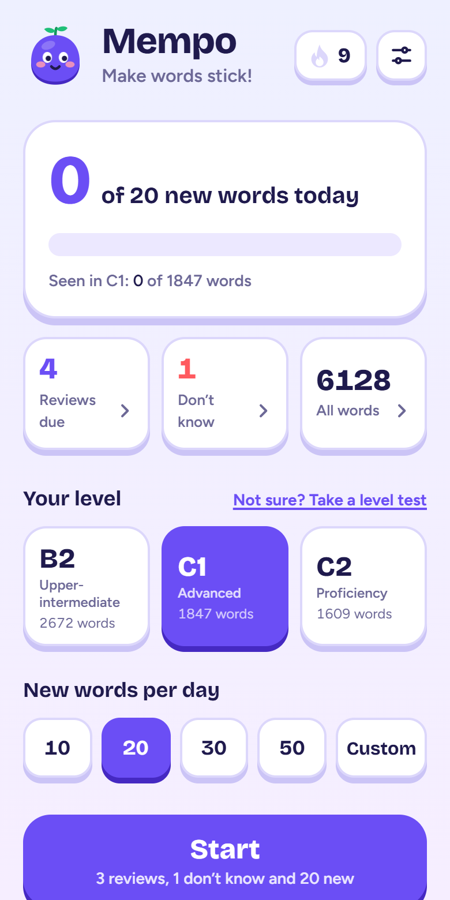
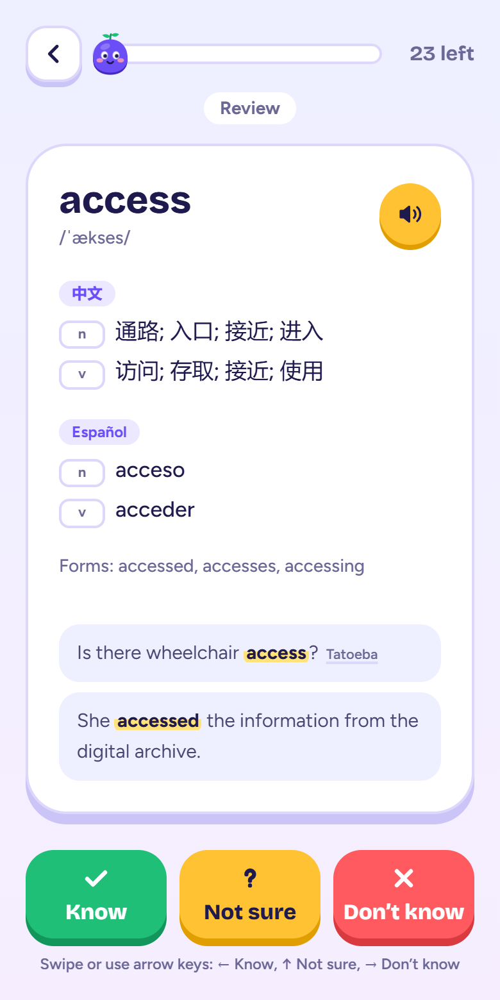
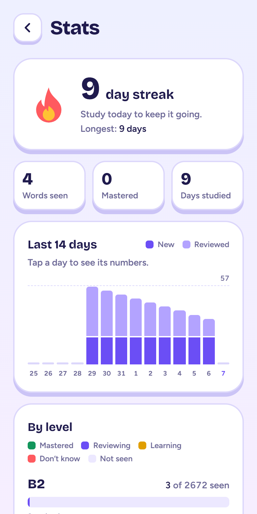

  

<h1 align="center">Mempo</h1>

<b>Make words stick!</b> Your little companion for learning words.

<a href="https://mempo.vercel.app/"><b>Open Mempo → mempo.vercel.app</b></a>

Mempo is a free web app for learning **B2, C1 and C2 English vocabulary** (the levels of the upper-intermediate, advanced and proficiency exams) a little every day. You swipe through word cards, say whether you know each word, and Mempo brings words back at the right time until they stick.

Every one of the **6,128 words** has Chinese (中文) and Spanish (Español) translations, example sentences and a British English recording.

  
  &nbsp;
  
  &nbsp;
  

## What it does

- **Daily goal**: pick 10, 20, 30, 50 or any number of new words a day.
- **Swipe cards**: swipe or tap Know, Not sure or Don't know. Tap a card to flip it and see the meaning.
- **Spaced repetition**: words you know come back after 1, 3, 7, 14, 30 and 60 days, then count as mastered.
- **"Don't know" list**: words you missed, to practise until you get them right on two different days.
- **Level test**: 30 random words tell you which level to start with.
- **Word list**: search every word in English, Chinese or Spanish.
- **Stats**: daily streak, 14-day chart and progress per level.
- **Works offline**, can be **installed like an app**, and has a **dark mode**.
- **Free, no account, no ads.** Your progress stays on your device.

## How to use it

1. Open [mempo.vercel.app](https://mempo.vercel.app/).
2. Choose **your level** (B2, C1 or C2). Not sure? Tap **Take a level test**.
3. Choose **how many new words a day** you want.
4. Tap **Start**. For each card:
   - Read the word and the example. Tap 🔊 to hear it.
   - Tap the card to see the translations.
   - Answer:

     | Answer | Swipe | Button | Keyboard |
     |---|---|---|---|
     | Know | left | ✓ Know | ← |
     | Not sure | up | ? Not sure | ↑ |
     | Don't know | right | ✕ Don't know | → |

     You can swap left and right in **Settings**. On a computer, **Space** flips the card and **Esc** leaves.
5. Words you don't know come back a few cards later, until you know them.
6. Come back tomorrow. **Start** always shows reviews that are due first, then your "Don't know" words, then new words. Study every day to keep your 🔥 streak.

The tiles on the home screen open **Reviews due** (only the words to review today), **Don't know** (your hard words, with a "Practise these" button) and **All words**. The 🔥 button opens **Stats**, the sliders button opens **Settings**.

## Install it on your phone or computer

Mempo is a web app: you install it from the browser, not from an app store. It then gets its own icon, opens full screen, and works without internet. The app also shows these steps: tap **Install** on the home screen or in **Settings → Offline**.

### iPhone and iPad

1. Open [mempo.vercel.app](https://mempo.vercel.app/) in **Safari**.
2. Tap the **Share** button (a square with an arrow, at the bottom on iPhone, at the top on iPad).
3. Scroll down and tap **Add to Home Screen**, then **Add**.

On iOS 16.4 or later, Chrome and Edge have the same Share → Add to Home Screen option.

### Android

1. Open [mempo.vercel.app](https://mempo.vercel.app/) in **Chrome** (Edge and Samsung Internet work too).
2. Tap **Install** in Mempo, or open the browser menu **⋮** and tap **Install app** (or **Add to Home screen**).
3. Confirm. Mempo appears with your other apps.

### Windows, Mac, Linux and Chromebook

- **Chrome or Edge**: click **Install** in Mempo, or the install icon at the right end of the address bar, or menu → **Install Mempo**. It opens in its own window and gets a Start menu, Dock or launcher entry.
- **Safari on a Mac** (macOS 14 Sonoma or later): menu bar → **File** → **Add to Dock**.
- **Firefox** on a computer can't install web apps. Mempo still works in a normal tab.

### Uninstall

Remove it like any other app: long-press the icon and choose Remove (phones), or open the app's menu → Uninstall (Chrome and Edge on computers). On iPhone, deleting the app also deletes its progress, so download a backup first.

## Offline use

After your first visit, Mempo and all its words work without internet.

Pronunciations are saved as you hear them. To save all of them at once (about 51 MB), go to **Settings → Offline → Save all for offline**. If a recording isn't saved yet, your device's own voice reads the word.

When a new version of Mempo is out, a message says **"A new version is ready"**. Tap **Update** when you're ready; it never interrupts a study session.

## Your progress and backups

There's no account: your progress is saved **in this browser on this device**. That means:

- A different phone, computer or browser starts empty.
- On iPhone, the installed app and Safari keep separate progress.
- Clearing your browser data deletes your progress.

To copy it to another phone, tablet or browser, use **Settings → Move to another device**:

- On the device that has your progress, tap **Show QR code**.
- Scan it with the other device's camera, or open Mempo there and tap **Enter a code** (8 letters and numbers, shown under the QR code). It shows what's coming and asks before replacing the progress there.
- On iPhone or iPad with Mempo on the Home Screen, type the code in the installed app: the camera opens Safari, which keeps its own progress.
- The code works for 10 minutes. Until then your progress waits on Mempo's server, then it's deleted.

To keep it safe, use **Settings → Your progress**:

- **Download backup** saves a small file (`mempo-backup-YYYY-MM-DD.json`).
- **Restore backup** loads that file on any device or browser. It shows what's in the file and asks before replacing the progress there.
- **Start over** deletes all your progress (your settings stay).

## Settings

- **Theme**: Light, Dark or Auto (follows your device).
- **Translations**: show Chinese, Spanish or both.
- **Swiping**: "Know" on the left (default) or on the right.
- **Daily reminder**: a notification at the time you pick (06:00 to 23:00), only on days you haven't studied yet. If your streak is still alive, it reminds you of it. Turn it on separately on each device. On iPhone and iPad (iOS 16.4 or later), install the app first and turn it on from the installed app. To send it, Mempo's server keeps only this device's notification address, the time, your time zone and the last day you studied; turning the reminder off deletes them.
- **Offline**: install the app and save pronunciations.
- **Move to another device**: QR code or code to copy your progress.
- **Your progress**: backup, restore, start over.
